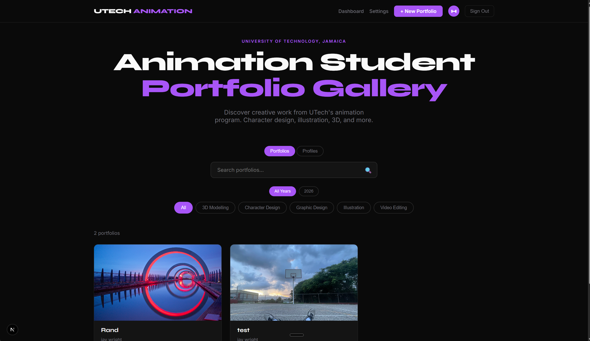
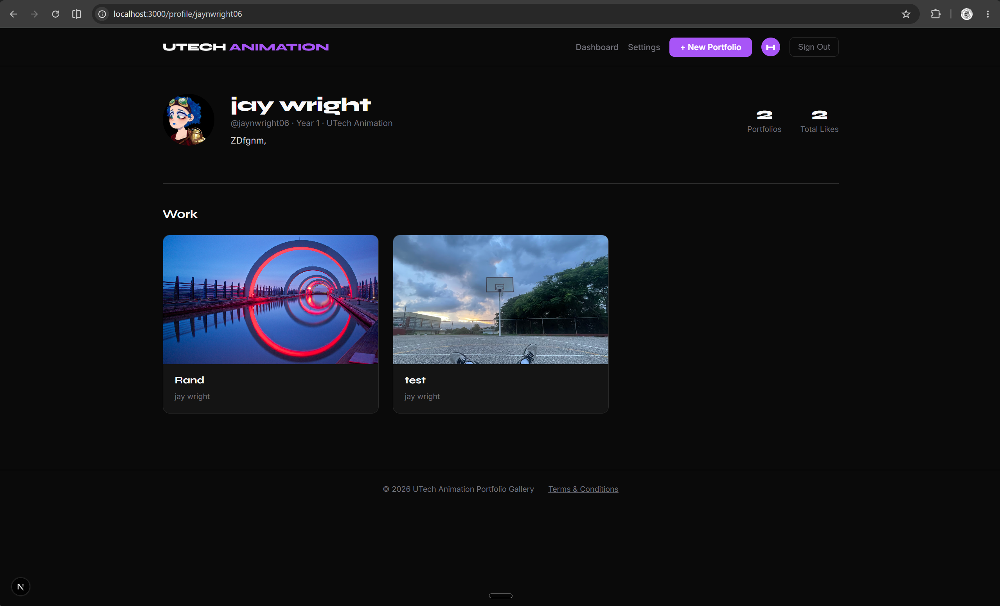
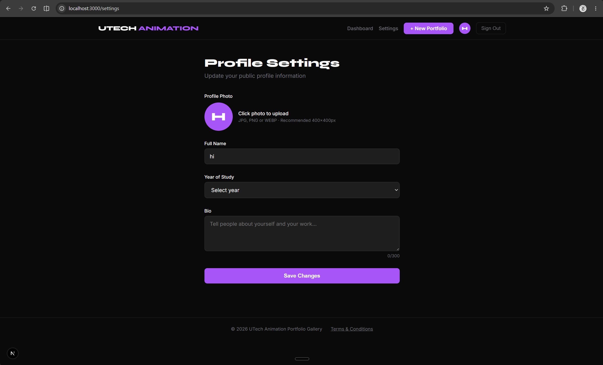
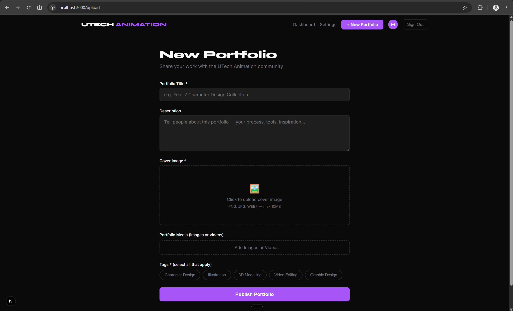
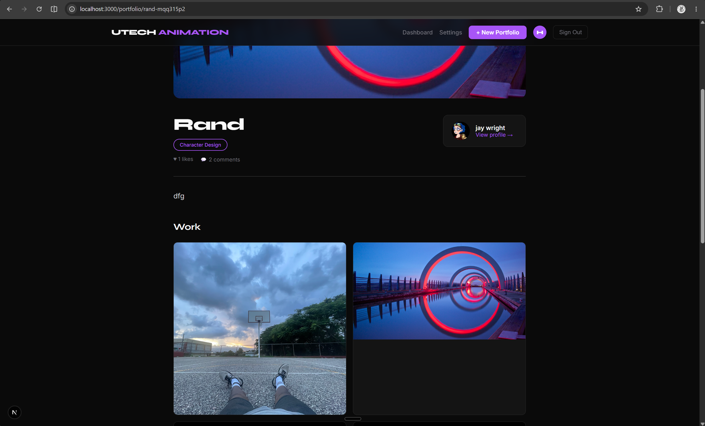
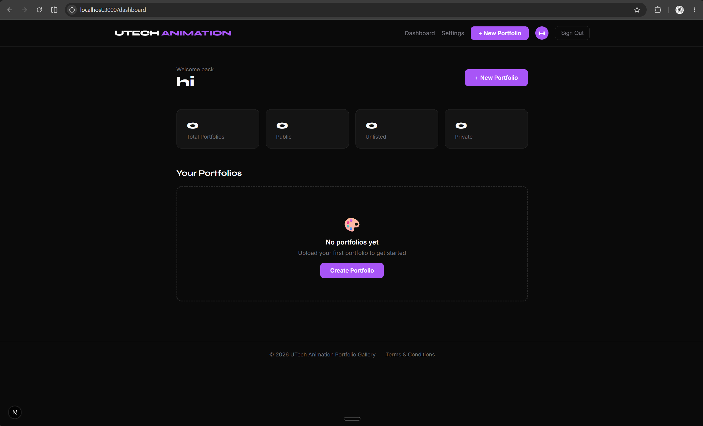

# UTech's Animation — Student Portfolios

A full-stack portfolio platform built for animation students at the **University of Technology, Jamaica**. Students can upload and showcase their work, and anyone can browse portfolios without needing an account — similar to Behance.

**Live site:** https://utech-animation.vercel.app

---

## Screenshots

> These show the earlier demo design. The current look is described under [Design](#design).

### Discovery Feed

The home page features an animated hero, tag filters, year filters, and a staggered portfolio grid. Visitors can browse without an account.

### Student Dashboard

Students manage all their portfolios in one place with visibility controls (Public, Unlisted, Private), edit access, and status indicators for warnings, takedowns and appeals.

### Profile Settings

Students can upload a profile avatar, set their year of study, and write a bio — all reflected instantly across the platform.

### New Portfolio

The upload flow lets students add a title, description, cover image, media items (images and video), and tags in one form.

### Portfolio View

Each portfolio has a full-page view with a cover image, tags, like and comment counts, a clickable owner card, a zoomable/pannable media lightbox, likes, comments, and a report button.

### Public Profile

Every student gets a public profile at `/profile/[username]` showing their avatar, bio, year of study, total portfolios, total likes received, and a grid of all their public work.

---

## What It Does

### For Visitors
- Browse all public student portfolios on an animated discovery feed
- Filter by tag (Character Design, Illustration, 3D Modelling, Video Editing, Graphic Design)
- Filter by upload year
- Search portfolios by title
- Search students by name
- View individual portfolios with a zoomable, pannable media lightbox
- See like and comment counts without an account

### For Students
- Sign in with Microsoft using a UTech student account (see [Sign-in](#sign-in-microsoft))
- Create a portfolio in four short steps (details → tags → media → review) with a cover image, description, 1–3 tags, and extra media
- Set portfolio visibility: **Public**, **Unlisted** (link-only), or **Private**
- Edit portfolios — add or remove media items
- Like and comment on any public portfolio
- View a public profile page showing all your work
- Upload a profile avatar and edit bio and year of study
- Receive admin warnings with the ability to submit a counter statement
- Submit one appeal if a portfolio is taken down
- See the status of takedowns, appeals, and scheduled deletion dates

### For Admins
- Full moderation panel at `/admin`
- Search portfolios by title or student name, filter by year
- Issue timed warnings (3 days, 1 week, 2 weeks) without affecting portfolio visibility
- Review counter statements submitted by students after a warning
- Green light a portfolio (clear the warning) or escalate to takedown
- Take down portfolios with a required reason
- Students receive one appeal — admin can approve or deny
- Denied appeals lock the portfolio and schedule permanent deletion 1 year from denial date
- Admin override to reset a denied appeal if a mistake was made
- Manage reports (Inappropriate Content, Copyright) with card-spread view per portfolio
- Update report status: Pending → Reviewed → Actioned / Dismissed

---

## Tech Stack

| Layer | Technology |
|---|---|
| Framework | Next.js 16 (App Router) — read `AGENTS.md` first |
| Database | Supabase (PostgreSQL) |
| Auth | Supabase Auth |
| Storage | Supabase Storage |
| Animations | CSS keyframes + Framer Motion |
| Styling | Tailwind CSS v4 + CSS variables in `src/app/globals.css` |
| Icons | lucide-react |
| Fonts | Baloo 2 (logo, headings) + Inter (body), self-hosted via `next/font/local` |
| Deployment | Vercel |

---

## Project Structure

```
src/
├── app/
│   ├── page.tsx                    # Discovery feed (home)
│   ├── login/                      # Sign-in page (Microsoft + temporary demo form)
│   ├── auth/callback/route.ts      # Finishes Microsoft sign-in
│   ├── fonts/                      # Self-hosted font files + licences
│   ├── icon.svg                    # Favicon (the owl)
│   ├── dashboard/page.tsx          # Student portfolio management
│   ├── upload/page.tsx             # Create portfolio
│   ├── edit/[id]/page.tsx          # Edit portfolio
│   ├── portfolio/[slug]/page.tsx   # Public portfolio view
│   ├── profile/[username]/page.tsx # Public profile page
│   ├── settings/page.tsx           # Profile settings + avatar upload
│   ├── admin/page.tsx              # Admin moderation panel
│   └── terms/page.tsx              # Terms and conditions
├── components/
│   ├── brand/
│   │   ├── Owl.tsx                 # The owl logo (colour + one-colour)
│   │   ├── Wordmark.tsx            # "UTech's Animation" logo text
│   │   ├── Decor.tsx               # Stars, paint drips, bouncing-ball loader, drip reveal
│   │   └── EmptyState.tsx          # Owl + message for empty lists
│   ├── layout/
│   │   ├── Navbar.tsx              # Top bar + phone tab bar
│   │   └── MotionProvider.tsx      # Makes Framer Motion respect "reduce motion"
│   └── ui/
│       ├── AnimatedCard.tsx        # Portfolio card + masonry grid
│       ├── CopyLinkButton.tsx      # Copy link / share sheet
│       ├── SignOutButton.tsx       # Sign-out on phones
│       ├── AdminClient.tsx         # Admin panel client component
│       ├── Avatar.tsx              # Avatar display + upload
│       ├── DashboardClient.tsx     # Student dashboard interactions
│       ├── EditClient.tsx          # Portfolio edit form
│       ├── Lightbox.tsx            # Zoom + pan media viewer
│       ├── LikesAndComments.tsx    # Like button + comment thread
│       ├── ReportButton.tsx        # Report submission form
│       ├── SearchAndFilter.tsx     # SearchBox (hero) + FilterBar (tags, year)
│       └── SettingsClient.tsx      # Profile settings form
└── lib/
    ├── supabase.ts                 # Browser client
    └── supabase-server.ts          # Server client (SSR)
```

---

## Design

The look was agreed on a storyboard in November 2026. In short:

- **Colours:** the brief's tokens — accent `#a855f7`, background `#0a0a0a`, surfaces `#141414` / `#1e1e1e`, border `#2a2a2a`, text `#fafafa`. White text sits on `#9333ea` (white on `#a855f7` is too faint). Small grey text uses `#a1a1aa`. Four extra purple shades and the warning/danger colours are all in `src/app/globals.css`.
- **Type:** Baloo 2 for the logo and headings, Inter for everything else.
- **Logo:** the owl in a painter's beret and scarf with a paintbrush (`src/components/brand/Owl.tsx`), next to the words "UTech's Animation". It replaces the Knight Cap mascot, which belongs to the yearly showcase.
- **Feeling alive:** a purple space background with slowly drifting stars, paint drips under banners, tags as tilted stickers, a free-flow (masonry) grid, a bouncing-ball loader, a "pop" on likes and copy-link, and a purple drip that wipes away when a portfolio opens.
- **Phones first:** a bottom tab bar with a big + for new work; portfolio pages swap it for a like / comments / copy-link bar. Everything is checked at 375 px wide and touch targets are at least 44 px.
- **Calm mode:** when a device has "reduce motion" switched on, all of the above becomes simple fades (CSS block at the end of `globals.css`, plus `MotionProvider`).

Where to change things: colours and reusable classes (`.btn`, `.card`, `.field`, `.sticker`, `.nebula`, …) are in `globals.css`; the logo pieces are in `src/components/brand/`.

---

## Sign-in (Microsoft)

The sign-in page's main button uses Supabase's **Azure (Microsoft)** provider and returns through `/auth/callback`. Until that provider is set up, the button shows an error, so the old email + password form is still available under **"Demo sign-in with email (temporary)"**.

To finish the switch (part of Phase 1 in the project brief):

1. Register an app in Microsoft Entra and enable the **Azure** provider in Supabase (**Authentication → Providers**), following Supabase's Azure guide, including the verified-email (`xms_edov`) step.
2. In Supabase **Authentication → URL Configuration**, add `https://<your-site>/auth/callback` (and `http://localhost:3000/auth/callback` for local work) to the redirect URLs.
3. Add the "Before User Created" hook that only allows `@students.utech.edu.jm` emails and invited staff (see the project brief, section 6.1).
4. Delete the `<details>` "Demo sign-in" block in `src/app/login/LoginClient.tsx` and the email/password code above it.

---

## Database Schema

| Table | Purpose |
|---|---|
| `profiles` | Extended user data (name, username, bio, avatar, year) |
| `portfolios` | Portfolio records with visibility + status fields |
| `portfolio_items` | Individual media items within a portfolio |
| `portfolio_tags` | Many-to-many join between portfolios and tags |
| `tags` | Tag definitions (Character Design, Illustration, etc.) |
| `likes` | One like per user per portfolio |
| `comments` | Comments on portfolios |
| `reports` | User-submitted reports (inappropriate content / copyright) |
| `takedowns` | Admin takedown records with appeal tracking |
| `warnings` | Timed admin warnings with counter statement support |
| `portfolio_credits` | Collaborators on group projects (invited / accepted / declined) |
| `staff_invites` | Lecturer emails allowed to sign up, with their role |
| `audit_log` | Every moderation decision (who, what, when) |

Roles (`student`, `moderator`, `admin`) live in `profiles.role`; the demo's `admin_roles`
table is gone. The full schema is in `supabase/migrations/` (see **Database** below).

### Portfolio Status Flow

```
active → (warning issued) → still active, yellow review card for admin
active → taken_down → pending_appeal → active (approved)
                                     → denied_appeal → [deleted after 1 year]
```

---

## Database

Everything in the database (tables, Row Level Security policies, functions, triggers,
the fixed tags and the storage buckets) is in `supabase/migrations/`, one concern per file.
Never change the database only in the Supabase dashboard; add a migration instead
(see `RUNBOOK.md` → "Database changes").

You need the [Supabase CLI](https://supabase.com/docs/guides/local-development/cli/getting-started)
and Docker Desktop (running).

```bash
supabase start      # start a local Supabase (database, auth, storage) in Docker
supabase db reset   # rebuild the local database from scratch using every migration
supabase test db    # run the SQL tests in supabase/tests/ (pgTAP)
supabase stop       # stop it when you are done
```

`supabase status` shows the local URLs and keys. They are for your machine only.

The tests prove, among other things, that visitors and other students cannot read
pending work, and that students cannot change moderation fields.

When querying `profiles` or `portfolios` from app code, **list the columns; never
use `select('*')`**. Some columns are hidden on purpose and `*` would fail with
"permission denied". See `RUNBOOK.md`.

---

## Getting Started

### Prerequisites
- Node.js 20.9+ (required by Next.js 16)
- A Supabase project

### Installation

```bash
# Clone the repo
git clone https://github.com/WrightJayN/utech-animation-portfolio.git
cd utech-animation-portfolio

# Install dependencies
npm install

# Add environment variables
cp .env.example .env.local
# Fill in NEXT_PUBLIC_SUPABASE_URL and NEXT_PUBLIC_SUPABASE_ANON_KEY
# (never put the service-role key in a NEXT_PUBLIC_ variable)

# Run development server
npm run dev
```

Open [http://localhost:3000](http://localhost:3000).

---

## Environment Variables

```
NEXT_PUBLIC_SUPABASE_URL=your_supabase_project_url
NEXT_PUBLIC_SUPABASE_ANON_KEY=your_supabase_anon_key
```

---

## Making Someone an Admin

The **first** admin is set once in the Supabase SQL Editor:

```sql
-- Get the user's ID first
select id, email from auth.users;

-- Then give them the admin role
update profiles set role = 'admin' where id = 'paste-user-id-here';
```

After that, an admin changes roles from the app with the `set_user_role` function,
which is recorded in `audit_log`. See `RUNBOOK.md`.

---

## Terms and Conditions

The platform includes a full terms and conditions page at `/terms` covering:
- Content standards and eligibility
- Portfolio visibility options
- Reporting process and report statuses
- Warning system and durations
- Takedown process and student rights
- One-appeal policy and finality of denied appeals
- Data deletion schedule (1 year after appeal denial)
- Admin override provisions
- Intellectual property and licensing

---

## Features Roadmap

- Email notifications for warnings, takedowns and appeal outcomes
- Batch admin actions
- Portfolio analytics (view counts)
- Featured / staff picks section
- Export portfolio as PDF

---

## Built By

Developed as a full-stack hackathon style build for the UTech Animation program.

**University of Technology, Jamaica — Animation Program**  
https://utech-animation.vercel.app